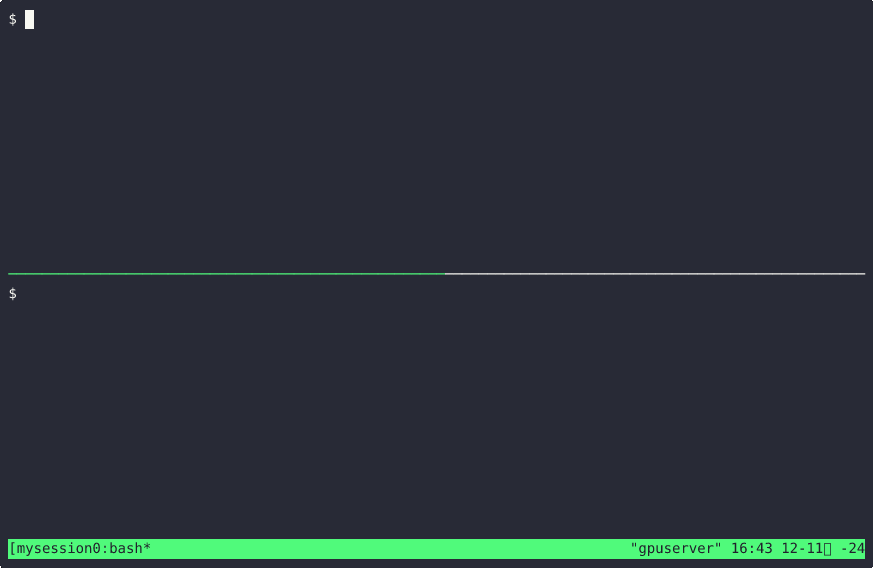
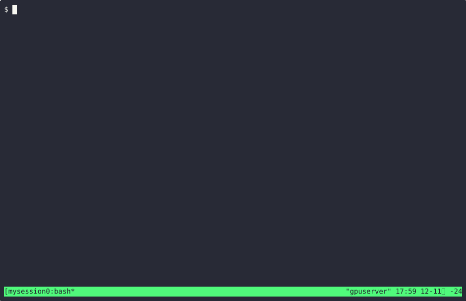

[한국어](https://github.com/kangtegong/pyftrace/blob/main/README-ko.md)

# pyftrace

## Introduction

**pyftrace** is a lightweight Python function tracing tool designed to monitor and report on function calls within Python scripts. It leverages sys.setprofile(Python 3.8 ~ 3.11), sys.monitoring(Python 3.12 ~) to monitor Python events and trace functions based on the results. With pyftrace, you can trace function calls across multiple modules, visualize call hierarchies, and generate execution time reports.



Key features of pyftrace include:

- **Function Call/Return Tracing**: Monitor calls/returns to functions in your Python script and imported modules.
- **Built-in Function Tracing**: Optionally trace built-in functions like `print` using the `--verbose` flag.
- **Multiple Module Support**: Trace functions across multiple files within your project.
- **Execution Reports**: Generate reports detailing function execution times and call counts with the `--report` flag.
- **Path Tracing**: Trace the path of traced Python file using the `--path` flag.
- **TUI Mode**: Run pyftrace in a Text User Interface (TUI) mode using the `tui` command.
- **Threads and Processes**: Trace the threads of a program and the processes it starts with `multiprocessing` or `os.fork()`. Their lines are marked with `[tid N]` and `[pid N]`.
- **Function Filtering**: Filter the function you want to track with the `--function` and `--exclude-function` flag.

```
$ pyftrace --help
usage: pyftrace [options] [tui] (script | -m module) [args ...]

pyftrace: Python function tracing tool.

positional arguments:
  script                Path to the script to run and trace. Specify 'tui' before the script path to run in TUI mode.

options:
  -h, --help            show this help message and exit
  -V, --version         Show the version of pyftrace and exit
  -v, --verbose         Enable built-in and third-party function tracing
  -p, --path            Show file paths in tracing output
  -r, --report          Generate a report of function execution times
  -d DEPTH, --depth DEPTH
                        Limit the tracing output to DEPTH
  -n LINES, --max-lines LINES
                        Stop printing the trace after LINES lines. The program keeps running
  -c, --collapse        Print a call that repeats the one before it only once, followed by a repeat count
  -f FUNCTION, --function FUNCTION
                        Trace only calls of <function> and its subcalls. Can be repeated
  -e EXCLUDE_FUNCTION, --exclude-function EXCLUDE_FUNCTION
                        Exclude calls of <function> (and its subcalls) from tracing. Can be repeated
  -F PATH, --file PATH  Trace only functions defined in PATH: a file, a directory or a glob. Can be repeated
  -E PATH, --exclude-file PATH
                        Do not trace functions defined in PATH. Can be repeated
  -a, --argument        Show function arguments in tracing output (Python frames only)
  --format {json,text}  Output format: 'text' (default) or 'json', one JSON object per line
  -o OUTPUT, --output OUTPUT
                        Write tracing output to a file. The traced program's own output is not redirected
  -m MODULE             Run and trace a library module as a script, like 'python -m'.
                        Everything after MODULE is passed to the module.
```

## Usage

### Requirements

- **Python Version**: pyftrace requires **Python 3.8+**.

```bash
$ pyftrace [options] /path/to/python/script.py
```

### Installation

```
$ git clone https://github.com/kangtegong/pyftrace.git
$ cd pyftrace
$ pip install -e .
```

or

```
$ pip install pyftrace
```

> note: on Windows, windows-curses is required.

### Use with AI Coding Agents

pyftrace ships a skill that teaches a coding agent when and how to trace
a program: how to keep the output short, how to read it, and which
options answer which question.

For Claude Code, install the skill as a plugin.  At the prompt of a
session:

```
/plugin install pyftrace --marketplace kangtegong/pyftrace
```

or from a shell:

```
$ claude plugin install pyftrace --marketplace kangtegong/pyftrace
```

Other agents can read [skills/pyftrace/SKILL.md](skills/pyftrace/SKILL.md)
directly; copy it to wherever the agent looks for skills or
instructions.

The plugin installs only the skill.  The agent still needs the
`pyftrace` command (0.4.0 or later) in the environment the project
runs in: `pip install -U pyftrace`.


### Command-Line Options

- `--report` or `-r`: Generate a report of function execution times and call counts at the end of the script's execution.
- `--verbose` or `-v`: Enable tracing of built-in functions (e.g., print, len). Without this flag, pyftrace only traces user-defined functions.
- `--argument` or `-a`: Show function arguments for Python functions.
- `--output` or `-o <filename>`: Write tracing output to a file instead of stdout. The traced program's own output still goes to stdout.
- `--format <text|json>`: Choose the output format. With `json`, every trace event is printed as one JSON object per line, e.g. `{"event": "call", "depth": 1, "function": "foo", "line": 9}`.
- `-m <module> [args ...]`: Run and trace a module as `python -m` does, e.g. `pyftrace -m pytest tests/`. Everything after the module name is passed to the module, so pyftrace's own options must come before `-m`.
- `--path` or `-p`: Include file paths in the tracing output. 
- `--help` or `-h`: Display help information about pyftrace and its options.
- `--version` or `-V`: Display help information about pyftrace and its options.
- `--depth` or `-d`: Limit the depth of the function to be traced. 
- `--max-lines` or `-n <lines>`: Stop printing the trace after the given number of lines. The traced program keeps running to the end.
- `--collapse` or `-c`: Print a call that is identical to the previous one, including everything it calls, only once, followed by `... repeated N more times`. Useful for loops.
- `--function` or `-f`: Filter the names of function to be traced. Can be given more than once.
- `--exclude-function` or `-e`: Exclude the specified function from the trace. Can be given more than once.
- `--file` or `-F <path>`: Trace only functions defined in the given file, directory or glob pattern, or in a module or package given by name, e.g. `-F src/mypkg` or `-F mypkg.core`. Can be given more than once.
- `--exclude-file` or `-E <path>`: Do not trace functions defined in the given file, directory or glob pattern. Can be given more than once.

## TUI

To run pyftrace in TUI(Text User Interface) mode, use the `tui` command before the script path.

```bash
pyftrace [options] tui path/to/your_script.py
```

### Key Bindings

- `↑` or `↓`: Scroll up or down one line at a time.
- `PgUp` or `PgDn`: Scroll up or down one page at a time.
- `Home` or `End`: Jump to the beginning or end of the trace.
- `←` or `→`: Scroll left or right horizontally.
- `q`: Quit the TUI mode.



## Examples

The `examples/` directory contains a variety of Python files that can be traced using pyftrace. 

In this example, `main_script.py` imports and calls functions from `module_a.py` and `module_b.py`. We'll use pyftrace to trace these function calls and understand the flow of execution.

```python
# module_a.py
  1 def function_a():
  2     print("Function A is called.")
  3     return "ret_a"
```

```python
# module_b.py
  1 def function_b():
  2     print("Function B is called.")
  3     return "ret_b"
```

```python
# main_script.py
  1 from module_a import function_a
  2 from module_b import function_b
  3
  4 def main():
  5     result_a = function_a()
  6     result_b = function_b()
  7     print(f"Results: {result_a}, {result_b}")
  8
  9 if __name__ == "__main__":
 10     main()
```

### Basic Tracing

To trace function calls in main_script.py without including built-in functions or file paths:

```
$ pyftrace examples/module_trace/main_script.py
```

output:
```
Running script: examples/module_trace/main_script.py
Called main from line 10
    Called function_a from line 5
Function A is called.
    Returning function_a-> ret_a
    Called function_b from line 6
Function B is called.
    Returning function_b-> ret_b
Results: ret_a, ret_b
Returning main-> None
Returning <module>-> None
```

### Trace Built-in Functions with `--verbose`

```
$ pyftrace --verbose examples/module_trace/main_script.py
```

output:
```
Running script: examples/module_trace/main_script.py
Called main from line 10
    Called function_a from line 5
        Called print from line 2
Function A is called.
        Returning print
    Returning function_a-> ret_a
    Called function_b from line 6
        Called print from line 2
Function B is called.
        Returning print
    Returning function_b-> ret_b
    Called print from line 7
Results: ret_a, ret_b
    Returning print
Returning main-> None
Returning <module>-> None
```

### Showing File Paths with `--path`

```
$ pyftrace --path examples/module_trace/main_script.py
```

In this case, When a function is called, pyftrace displays it in the following format:

```
Called {function} @ {defined file path}:{defined line} from {called file path}:{called line}
```

- `{function}`: name of the function being called 
- `{defined file path}`: file path where the function is defined (enabled with `--path` option)
- `{defined line}`" line number in the defined file
- `{called line}` line number in the calling file
- `{called file path}` path to the file that contains the calling function (enabled with `--path` option)

output:
```
Running script: examples/module_trace/main_script.py
Called main@examples/module_trace/main_script.py:4 from examples/module_trace/main_script.py:10
    Called function_a@examples/module_trace/module_a.py:1 from examples/module_trace/main_script.py:5
Function A is called.
    Returning function_a-> ret_a @ examples/module_trace/module_a.py
    Called function_b@examples/module_trace/module_b.py:1 from examples/module_trace/main_script.py:6
Function B is called.
    Returning function_b-> ret_b @ examples/module_trace/module_b.py
Results: ret_a, ret_b
Returning main-> None @ examples/module_trace/main_script.py
Returning <module>-> None @ examples/module_trace/main_script.py
```

### Generating an Execution Report

To generate a summary report of function execution times and call counts:

```
$ pyftrace --report examples/module_trace/main_script.py
```

output:
```
Running script: examples/module_trace/main_script.py
Function A is called.
Function B is called.
Results: ret_a, ret_b

Function Name	| Total Execution Time	| Call Count
---------------------------------------------------------
main           	| 0.000082 seconds	| 1
function_a     	| 0.000022 seconds	| 1
function_b     	| 0.000008 seconds	| 1
```

### Combining `--verbose` and `--path`

To trace built-in functions and include file paths:

```
$ pyftrace --verbose --path examples/module_trace/main_script.py
$ pyftrace -vp examples/module_trace/main_script.py
```

output:
```
Running script: examples/module_trace/main_script.py
Called main@examples/module_trace/main_script.py:4 from examples/module_trace/main_script.py:10
    Called function_a@examples/module_trace/module_a.py:1 from examples/module_trace/main_script.py:5
        Called print@builtins from examples/module_trace/module_a.py:2
Function A is called.
        Returning print @ examples/module_trace/module_a.py
    Returning function_a-> ret_a @ examples/module_trace/module_a.py
    Called function_b@examples/module_trace/module_b.py:1 from examples/module_trace/main_script.py:6
        Called print@builtins from examples/module_trace/module_b.py:2
Function B is called.
        Returning print @ examples/module_trace/module_b.py
    Returning function_b-> ret_b @ examples/module_trace/module_b.py
    Called print@builtins from examples/module_trace/main_script.py:7
Results: ret_a, ret_b
    Returning print @ examples/module_trace/main_script.py
Returning main-> None @ examples/module_trace/main_script.py
Returning <module>-> None @ examples/module_trace/main_script.py
```

### Combining `--verbose` and `--report`

```
$ pyftrace --verbose --report examples/module_trace/main_script.py
$ pyftrace -vr examples/module_trace/main_script.py
```

output:
```
Running script: examples/module_trace/main_script.py
Function A is called.
Function B is called.
Results: ret_a, ret_b

Function Name	| Total Execution Time	| Call Count
---------------------------------------------------------
main           	| 0.000127 seconds	| 1
print          	| 0.000041 seconds	| 3
function_a     	| 0.000021 seconds	| 1
function_b     	| 0.000016 seconds	| 1
```


### Real-World Examples

The `examples/` directory also has programs built on large libraries. pyftrace leaves library code out unless `--verbose` is given, so their traces show the application code only.

- `django_example.py`: a one-file Django application with a middleware and two views, driven by the test client.
- `pytorch_example.py`: a training loop with a model class, training steps and an evaluation.

```
$ pip install django
$ pyftrace examples/django_example.py
Running script: examples/django_example.py
    Called main from line 83
        Called __init__ from line 63
        Returning __init__-> None
        Called __call__ from line 56
            Called article_list from line 199
                Called serialize from line 45
                Returning serialize-> {'id': 1, 'title': 'Tracing Python'}
                Called serialize from line 45
                Returning serialize-> {'id': 2, 'title': 'Tracing Django'}
            Returning article_list-> <JsonResponse status_code=200, "application/json">
        Returning __call__-> <JsonResponse status_code=200, "application/json">
GET /articles/ -> 200
...
        Called __call__ from line 56
            Called article_detail from line 199
                Called find_article from line 49
                Raised find_article-> Http404: No article 99
            Raised article_detail-> Http404: No article 99
        Returning __call__-> <HttpResponseNotFound status_code=404, "text/html; charset=utf-8">
GET /articles/99/ -> 404
    Returning main-> None
```

`article_list` is called from line 199 of a Django file: the line of the caller is shown even when the caller itself is not traced. Use `--path` to see which file it is.

### Notes
- simple-pyftrace.py is a simplified pyftrace script for the [Pycon Korea 2024](https://2024.pycon.kr/) presentation. It is about 100 lines of code, but has limited functionality. 

## LICENESE

MIT 

See [LICENSE](./LICENSE) for more infomation

## See Also

pyftrace is heavily inspired by:

- [ftrace](https://www.kernel.org/doc/Documentation/trace/ftrace.txt): Ftrace is an internal tracer for linux kernel.
- [uftrace](https://github.com/namhyung/uftrace): uftrace is a function call graph tracer for C, C++, Rust and Python programs.
